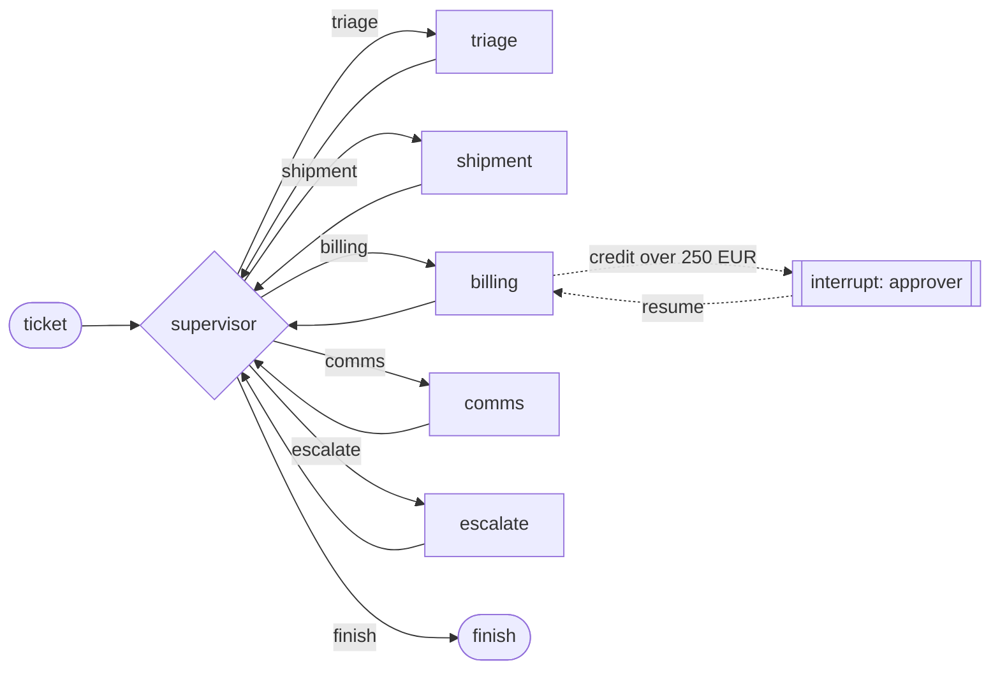

# Architecture

## The graph

- **Supervisor** picks the next step from the brain, then checks it: it must be a known
  step, a worker that already ran is not revisited, and the step budget is enforced.
  Choosing `escalate` runs the escalation tool, the only tool the supervisor has.
- **Workers** are bounded loops: ask the brain for an action, run it through the
  executor, show the brain the observation, until it hands off or hits
  `max_actions_per_visit`. A handoff carries facts (SLA state, rebooking, credit status)
  into shared state for later workers and the reply.
- **State** (`RunState`) holds the ticket, merged facts, the route taken, outcomes, a
  trace and counters. LangGraph checkpoints it after every node.

## The executor

Every tool call, from any brain, passes through the same steps:

| Step | Rejects with | Example |
|---|---|---|
| Tool exists, in the worker's scope | `validation`, `permission` | comms calling `issue_credit` |
| Strict schema | `validation` | `"amount_eur": "420"`, an unknown field |
| Ownership of shipment, invoice, customer | `not_found` | asking about another customer's shipment |
| Already succeeded under this key | (returns stored result) | retry, resume, duplicate ticket |
| Applied by the backend before a crash | (records and returns it) | process died after the write |
| Tool budget for the ticket | `budget` | a brain stuck in a loop |
| Policy guard | `policy`, `denied` | credit over cap, rebook costing +33%, reply with internal wording |
| Execute with retries | `transient` after 3 retries | backend timeouts |

The rejection is shown to the brain as an explicit error, so a model can correct itself,
and written to the ledger, so the auditor and the metrics see it.

## Determinism

Three things make a run reproducible:

1. **Decisions are recorded.** Each brain decision is stored under
   `(run, worker, visit, step)` before it is executed. LangGraph re-runs a node from its
   start when a run resumes after an interrupt; the node then replays stored decisions
   instead of asking the brain (or a model) again.
2. **Reads are cached per run.** A read with the same arguments in the same run returns
   the same observation, so the replayed decisions see what they saw the first time.
3. **Writes are keyed by business identity.** The key is a hash of the ticket id, the
   tool and the canonical arguments. Retrying, resuming, recovering or receiving the same
   ticket again cannot repeat a write.

## Approvals

`issue_credit` above the auto limit raises `ApprovalRequired` inside the executor. The
worker node turns it into `interrupt(request)`; the run pauses with the request (amount,
invoice, reason, fingerprint) visible to staff. `resume(approved, approver)` records the
decision against the fingerprint and the node re-runs. The approval is for that exact
call: a different amount or invoice has a different fingerprint and needs its own.

## Durability

| Store | Checkpoints | Ledger | Use |
|---|---|---|---|
| memory | `InMemorySaver` | `InMemoryLedger` | tests, demo, evaluation |
| sqlite | `SqliteSaver` | `SqlLedger.sqlite` | single node |
| postgres | `PostgresSaver` | `SqlLedger.postgres` | services; restart-safe |

`tests/test_graph.py::test_approval_survives_a_process_restart` pauses a run, discards
every object, rebuilds from SQLite and approves. CI does the same with the container and
PostgreSQL.

## Brains

| Brain | Decides by | Role |
|---|---|---|
| `RuleBrain` | Small generator programs per worker, written to the policy | Offline default, the reference |
| `LLMBrain` | Chat model with function calling; tool schemas from the Pydantic models; ticket fenced as data | Production path |
| `RogueBrain` | Tries unsafe actions first, then behaves like the rule brain | Guardrail test in the evaluation |

## Observability

- JSON log line per routing decision, approval, recovery, duplicate ticket and finished
  run, with the run id. Ticket text is not logged.
- OpenTelemetry spans per run and worker visit when the `otel` extra is installed.
- Prometheus: runs by status, blocked actions by kind, approvals by decision, request
  counts and latency.

A rise in `ops_blocked_actions_total{kind="policy"}` after a prompt or model change is
the first sign a model has started proposing things it should not.
